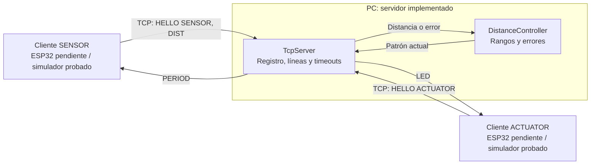

# Arquitectura

El servidor implementado corre en PC y escucha en IPv4 `0.0.0.0:5000`. Acepta una conexión activa por rol; las conexiones TCP son iniciadas por los clientes. En esta etapa, las pruebas sustituyen los ESP por sockets locales.

La aplicación usa texto ASCII con LF sobre TCP/IPv4. El despliegue físico utilizará WiFi IEEE 802.11 en la misma red local. La PC concentra el control; el firmware del actuador será responsable del parpadeo local. No hay comunicación directa entre objetos.

Se recomienda reservar la IP de la PC en DHCP y permitir conexiones entrantes al puerto configurado. La operación por WiFi, los circuitos y los firmwares funcionales aún requieren implementación y validación.
