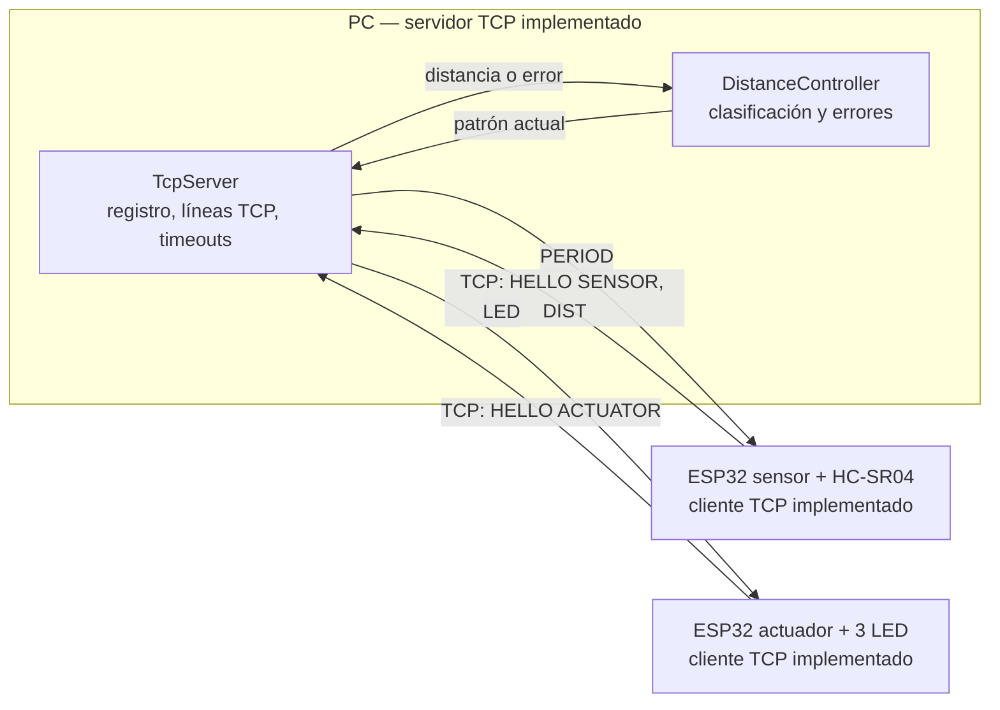

# Arquitectura

Sistema distribuido sobre red local WiFi (IEEE 802.11) con topología cliente-servidor: un servidor TCP en PC y dos clientes ESP32 que inician la conexión. No hay comunicación directa entre objetos; todo el control pasa por el servidor.

## Uso de las capas TCP/IP

| Capa | Tecnología |
|---|---|
| Aplicación | Protocolo propio de texto ASCII terminado en LF (ver [protocol.md](protocol.md)) |
| Transporte | TCP persistente; puerto 5000 del servidor |
| Internet | IPv4; el servidor usa una dirección fija o reservada por DHCP |
| Acceso a la red | WiFi IEEE 802.11 |

## Roles y responsabilidades

| Componente | Responsabilidad | Tecnología |
|---|---|---|
| Servidor | Registrar roles, recibir y clasificar lecturas, enviar y refrescar órdenes, gestionar fallas | Python 3 + `asyncio`, biblioteca estándar |
| Sensor | Medir distancia, enviar lecturas, aplicar `PERIOD`, reconectar | ESP32-WROOM-32 + HC-SR04, Arduino/C++ |
| Actuador | Recibir patrones, controlar tres LED con parpadeo local, apagar ante pérdida de control | ESP32-WROOM-32 + 3 LED, Arduino/C++ |

## Configuración de red

- Los tres dispositivos están en la misma red local.
- El servidor escucha en `0.0.0.0:5000`; los clientes se conectan a la IPv4 de la PC.
- Se recomienda reservar la IP de la PC en DHCP y permitir conexiones entrantes TCP al puerto 5000 en el firewall.
- El sistema fue validado de extremo a extremo con el prototipo físico (ver [testing.md](testing.md) y [results.md](results.md)).
