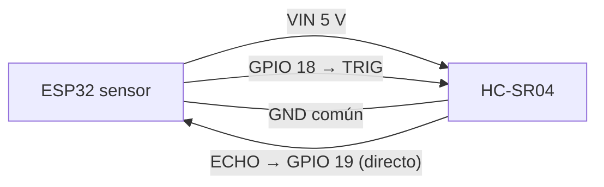
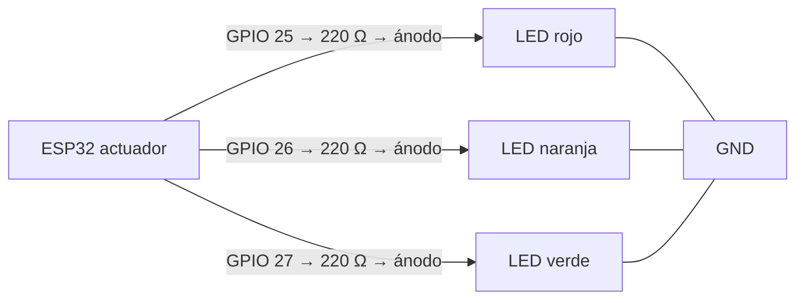

# Circuitos

Esquemático de ambos objetos en [assets/circuits.html](assets/circuits.html) (se abre en el navegador). Ambos circuitos se montaron y se probaron correctamente con las placas reales; no se requieren fotografías ni evidencias adicionales.

## Objeto sensor — ESP32 + HC-SR04

| Elemento | Conexión |
|---|---|
| Tarjeta | ESP32-WROOM-32; entorno PlatformIO `esp32doit-devkit-v1` |
| Alimentación del HC-SR04 | VCC → VIN (5 V) |
| TRIG | GPIO 18 |
| ECHO | GPIO 19 (conexión directa, sin resistencias) |
| Masa | GND común con la placa |
| Confirmación del montaje | `SENSOR_WIRING_CONFIRMED` en `sensor/include/config.h` |

> Esquemático completo del sensor en [assets/circuits.html](assets/circuits.html).

El equipo verificó experimentalmente que la conexión directa del ECHO (5 V) a un GPIO del ESP32 no daña ningún componente y es adecuada para esta práctica. Por eso el diseño **no incluye resistencias ni adaptación de nivel** en el sensor: el módulo se alimenta a 5 V (VIN) y comparte masa con la placa.

- `UltrasonicSensor::begin()` no configura ningún pin salvo que `SENSOR_WIRING_CONFIRMED` sea `true` y los GPIO de TRIG y ECHO sean válidos y distintos. Los GPIO del diseño (18 y 19) deben coincidir con `TRIGGER_PIN` y `ECHO_PIN` en `sensor/include/config.h`.
- Con el ejemplo (`config.h.example`, GPIO en `-1`) el firmware compila pero no activa ningún GPIO y representa cada lectura como `DIST ERR`; el montaje real usa los GPIO indicados arriba.

## Objeto actuador — ESP32 + 3 LED

| LED | GPIO | Resistencia en serie |
|---|---:|---|
| Rojo | 25 | 220 Ω |
| Naranja | 26 | 220 Ω |
| Verde | 27 | 220 Ω |

> Esquemático completo del actuador en [assets/circuits.html](assets/circuits.html).

- Los LED son activos a nivel alto: un GPIO en `HIGH` enciende el LED correspondiente.
- Cada LED lleva una resistencia en serie de 220 Ω y comparte masa con la placa.
- `LedController::begin()` no configura los pines mientras `LED_WIRING_CONFIRMED` sea `false`; el montaje real usa los GPIO indicados arriba.

El circuito del actuador se montó y se verificó con las placas reales durante las pruebas del prototipo (ver [testing.md](testing.md)).
