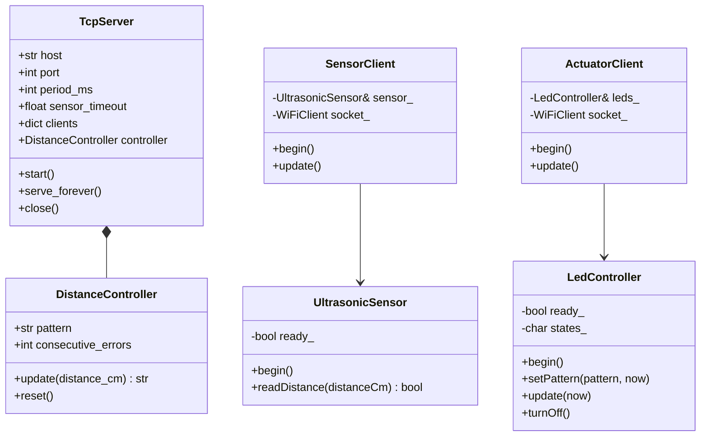

# Diagrama de clases

El sistema usa pocas clases, cada una con una responsabilidad evidente. El servidor concentra la clasificación; cada ESP32 separa la lógica del dispositivo (medición o LED) de la comunicación de red.

## Responsabilidades

- **Servidor** (`server/`): `TcpServer` gestiona conexiones, registro por rol, encuadre de líneas TCP, envío de órdenes y timeouts; `DistanceController` clasifica lecturas y tolera errores sin conocer sockets. `TcpServer` posee un `DistanceController`.
- **Sensor** (`sensor/`): `UltrasonicSensor` administra GPIO, disparo y conversión; `SensorClient` administra WiFi/TCP, registro, `PERIOD` y envío periódico. `SensorClient` usa una referencia a `UltrasonicSensor`.
- **Actuador** (`actuator/`): `LedController` aplica patrones y genera el parpadeo local no bloqueante; `ActuatorClient` administra WiFi/TCP, registro, recepción de órdenes y el watchdog de 5 s. `ActuatorClient` usa una referencia a `LedController`.

En cada firmware, `main.cpp` compone las dos clases (una instancia de cada una) e implementa `setup()` y `loop()`. Los parámetros se centralizan en `server/config.py` y en `include/config.h` de cada proyecto.

## Fuentes

- Servidor: [TcpServer](../server/tcp_server.py), [DistanceController](../server/distance_controller.py), [main.py](../server/main.py), [config.py](../server/config.py).
- Sensor: [UltrasonicSensor](../sensor/src/ultrasonic_sensor.cpp), [SensorClient](../sensor/src/sensor_client.cpp), [main.cpp](../sensor/src/main.cpp).
- Actuador: [LedController](../actuator/src/led_controller.cpp), [ActuatorClient](../actuator/src/actuator_client.cpp), [main.cpp](../actuator/src/main.cpp).
