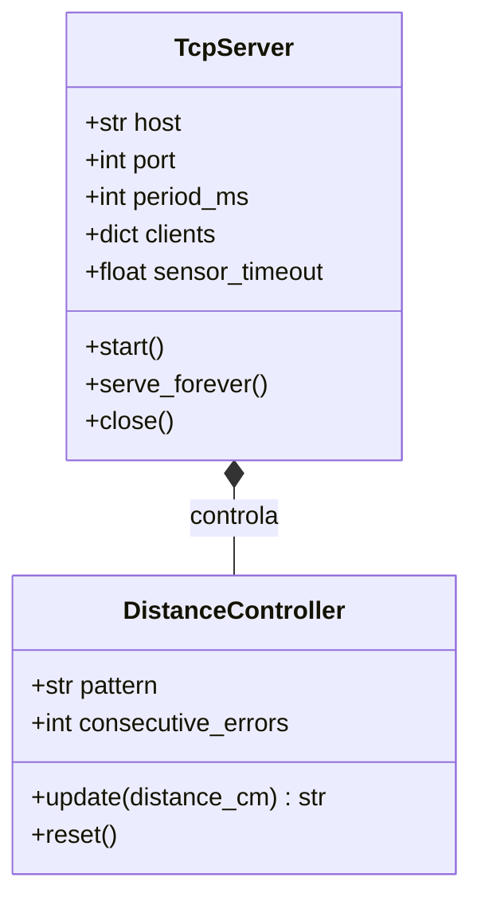

# Clases implementadas

`TcpServer` posee un `DistanceController`. La primera clase gestiona conexiones y tiempos; la segunda clasifica lecturas sin conocer sockets. Las operaciones públicas de `TcpServer` son asíncronas. `main.py` compone y ejecuta el servidor; `config.py` concentra constantes.

Fuentes: [TcpServer](../server/tcp_server.py) y [DistanceController](../server/distance_controller.py). Los ESP todavía no tienen clases de aplicación implementadas.
