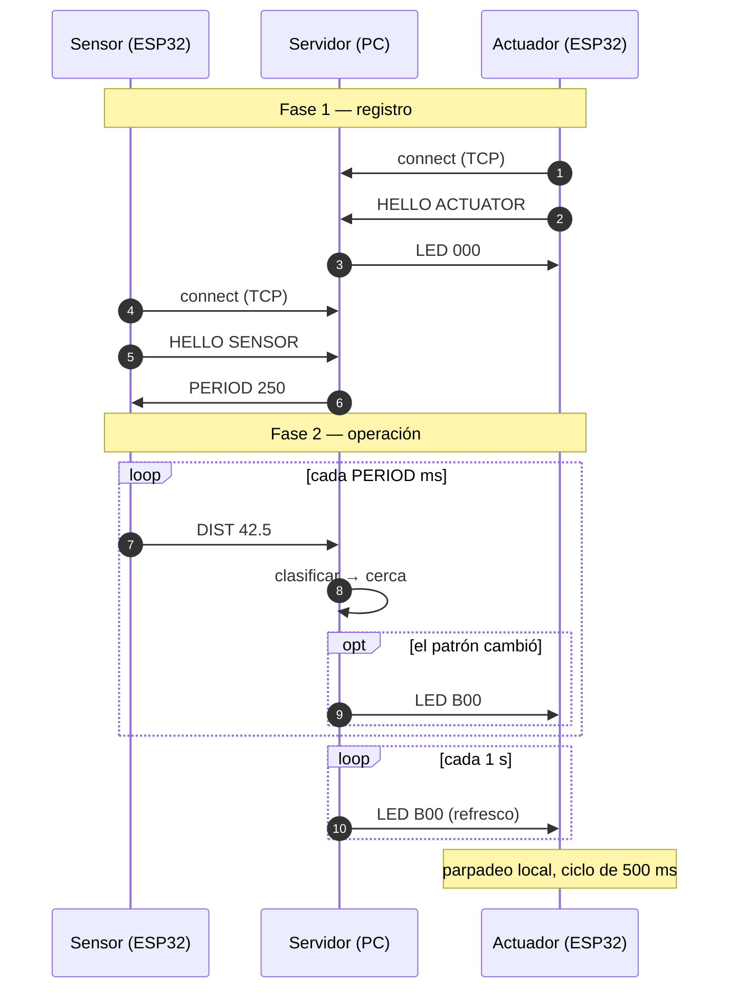
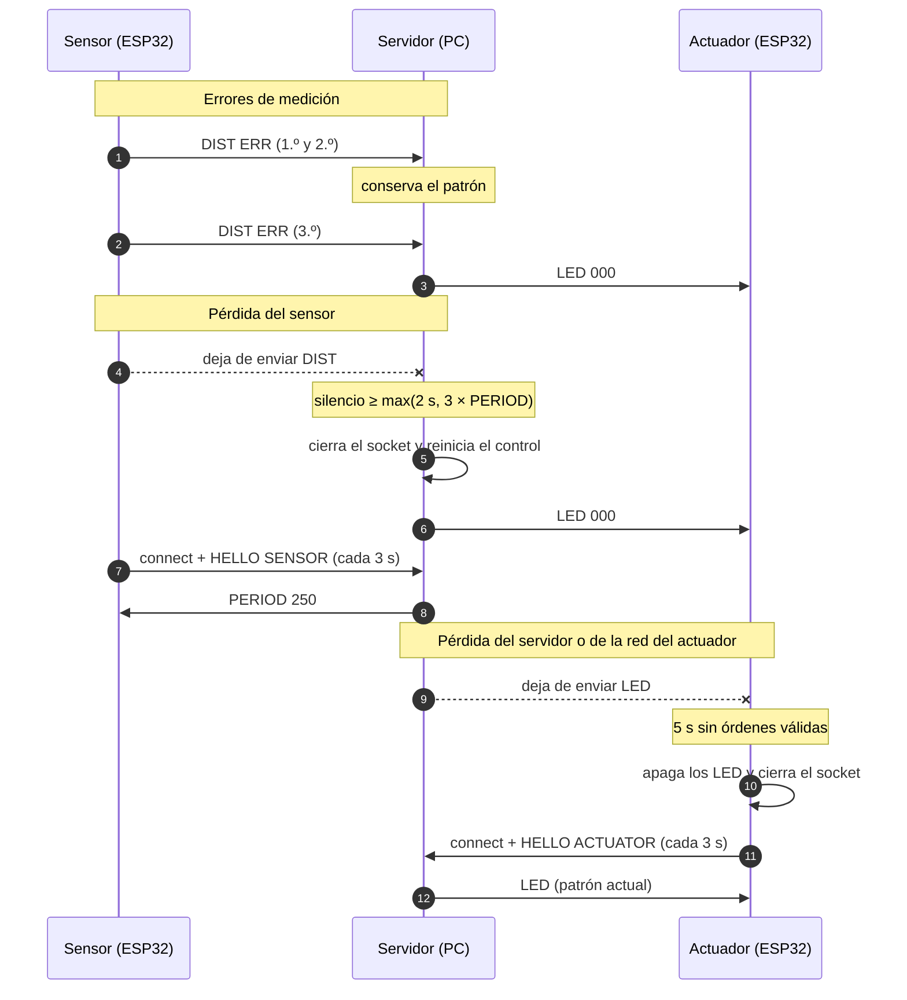

# Diagramas de secuencia

El servidor intercambia mensajes con ambos clientes. La operación del servidor está

**verificada con clientes simulados** por TCP en loopback y con el prototipo físico integrado.

## Operación normal

## Errores y pérdida de conexión

## Notas de comportamiento

- `DIST ERR` es un mensaje válido y renueva el plazo de recepción del sensor, aunque cuente como fallo de medición. Los mensajes malformados y las líneas parciales no renuevan ese plazo.
- Una desconexión explícita del sensor apaga el estado sin esperar el timeout.
- Un actuador que se registra recibe de inmediato el patrón vigente, aunque antes no estuviera conectado.
- La secuencia completa prevista del sistema, incluida la variante con servomotor, se conserva en [protocolo.md](../protocolo.md).
