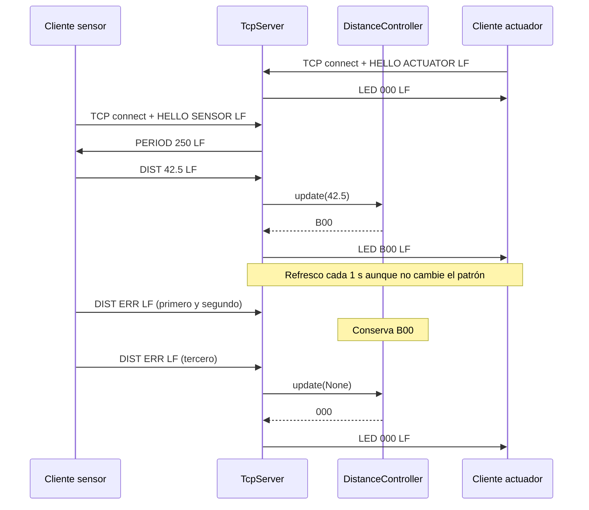
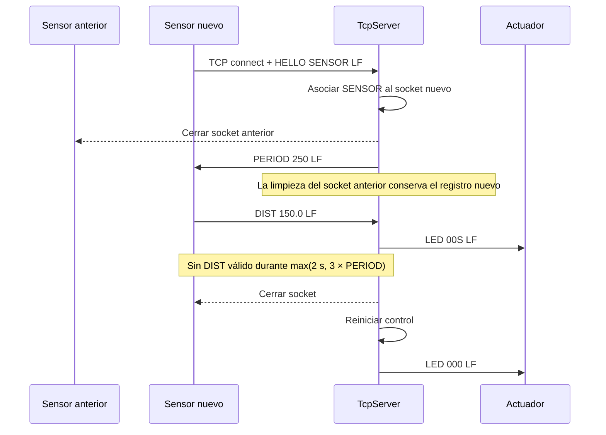

# Secuencias del servidor

Intercambio implementado y probado con clientes simulados. El parpadeo físico del actuador queda pendiente.

`DIST ERR` es un mensaje válido y renueva el plazo de recepción, aunque cuente como fallo de medición. Los mensajes malformados y las líneas parciales no renuevan ese plazo. Una desconexión explícita del sensor apaga el estado sin esperar el timeout.
