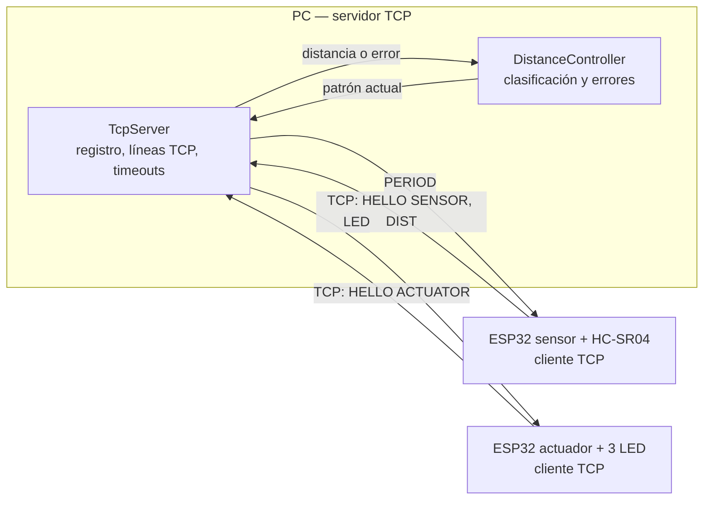
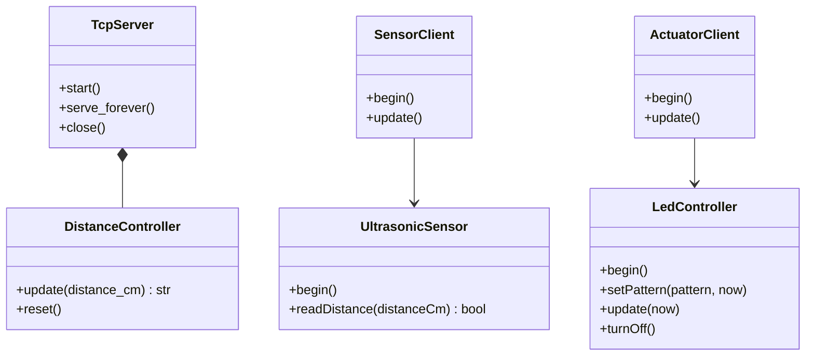
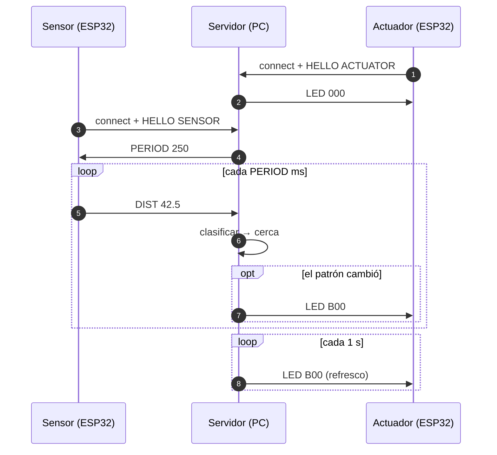

# Práctica 2 — Integración de Objetos Inteligentes con TCP/IP

**Carrera:** Ingeniería de Sistemas

**Asignatura:** SIS-234

**Integrantes:** Bustamante Alejandro, Corrales Jose, Lopez Rasshid

**Docente:** Marin Eduardo 

**Fecha:** 13 de octubre de 2026

**Repositorio:** <https://github.com/JoseCorralesAgreda/Proyecto-Practica-2-IOT>

Sistema distribuido con dos objetos inteligentes ESP32 y un servidor TCP en PC. El objeto sensor mide distancias con un HC-SR04; el servidor clasifica cada lectura y ordena al objeto actuador el patrón de tres LED correspondiente. Las conclusiones y recomendaciones de este informe se basan en la documentación viva del repositorio, enlazada a lo largo del texto.

---

## 1. Requerimientos funcionales y no funcionales

Fuente y detalle: [docs/requirements.md](docs/requirements.md).

### 1.1 Requerimientos funcionales

| ID | Requerimiento | Estado |
|---|---|---|
| RF1 | Medir la distancia con un HC-SR04 en el rango de 2 a 200 cm | Implementado y verificado con el prototipo físico |
| RF2 | Clasificar la distancia en tres rangos contiguos y sin solape | Implementado (`DistanceController`) y verificado |
| RF3 | Producir un comportamiento distinto por rango | Implementado en el actuador y verificado físicamente |
| RF4 | Intercambiar datos por sockets TCP sobre WiFi con un protocolo propio | Implementado y verificado de extremo a extremo |

### 1.2 Lógica de control

| Distancia válida | Clasificación | Patrón `LED` |
|---|---|---|
| 2 ≤ d < 50 cm | Cerca | `B00` (rojo parpadeando) |
| 50 ≤ d < 100 cm | Intermedia | `0B0` (naranja parpadeando) |
| 100 ≤ d ≤ 200 cm | Lejos | `00S` (verde fijo) |

Una lectura fuera de 2–200 cm o no numérica se considera inválida. Dos lecturas inválidas consecutivas conservan el patrón; la tercera apaga los LED (`000`). La pérdida o el silencio del sensor durante `max(2 s, 3 × PERIOD)` apaga las salidas y cierra la conexión.

### 1.3 Requerimientos no funcionales

| Atributo | Objetivo | Estado |
|---|---|---|
| Estabilidad | ≥ 10 minutos sin reinicios ni bloqueos | Verificado con el prototipo físico |
| Exactitud | Error absoluto ≤ 3 cm dentro de 2–200 cm | Verificado con el prototipo físico |
| Respuesta | ≤ 1 s del cambio físico a la actuación | Verificado con el prototipo físico |
| Muestreo | ≥ 2 lecturas/s (periodo nominal 250 ms) | Verificado con el prototipo físico |

El código es modular y orientado a objetos, con constantes centralizadas y sin bibliotecas externas.

---

## 2. Análisis y diseño

### 2.1 Arquitectura del sistema

Detalle: [docs/architecture.md](docs/architecture.md).



Ambos objetos inician la conexión hacia el servidor y este concentra el control; no hay comunicación directa entre objetos.

| Capa TCP/IP | Tecnología |
|---|---|
| Aplicación | Protocolo propio de texto ASCII terminado en LF |
| Transporte | TCP persistente; puerto 5000 del servidor |
| Internet | IPv4; el servidor usa dirección fija o reservada por DHCP |
| Acceso a la red | WiFi IEEE 802.11 |

### 2.2 Circuitos de cada objeto inteligente

Detalle y esquemático: [docs/circuits.md](docs/circuits.md) y [docs/assets/circuits.html](docs/assets/circuits.html).

**Objeto sensor — ESP32 + HC-SR04:** VCC → VIN (5 V), TRIG → GPIO 18, ECHO → GPIO 19 y masa común. El ECHO se conecta **directamente**, sin resistores ni adaptación de nivel; el equipo verificó experimentalmente que no daña componentes.

**Objeto actuador — ESP32 + 3 LED:**

| LED | GPIO | Resistor en serie |
|---|---:|---|
| Rojo | 25 | 220 Ω |
| Naranja | 26 | 220 Ω |
| Verde | 27 | 220 Ω |

Los LED son activos a nivel alto, cada uno con su resistor y masa común con la placa.

### 2.3 Diagrama de clases

Detalle: [docs/classes.md](docs/classes.md).



Cada firmware compone dos clases (lógica del dispositivo y comunicación) en su `main.cpp`.

### 2.4 Diagrama de secuencia

Detalle: [docs/sequence.md](docs/sequence.md).



Frente a fallas: tres errores consecutivos apagan los LED; el silencio o la desconexión del sensor durante `max(2 s, 3 × PERIOD)` reinician el control; el actuador apaga y cierra tras 5 s sin órdenes válidas; ambos clientes reintentan cada 3 s repitiendo el `HELLO`.

### 2.5 Especificación del protocolo de aplicación

Detalle: [docs/protocol.md](docs/protocol.md) y referencia [protocolo.md](protocolo.md).

Texto ASCII sobre TCP persistente, un mensaje por línea terminada en LF, forma `COMANDO [argumento]` y un único espacio separador. Longitud máxima: 32 bytes incluido LF.

| Dirección | Mensaje | Argumento | Ejemplo |
|---|---|---|---|
| ESP → servidor | `HELLO` | `SENSOR` o `ACTUATOR` | `HELLO SENSOR` |
| Sensor → servidor | `DIST` | Distancia en cm con un decimal, o `ERR` | `DIST 42.5` / `DIST ERR` |
| Servidor → sensor | `PERIOD` | Periodo en ms (100–5000) | `PERIOD 250` |
| Servidor → actuador | `LED` | Tres estados (rojo, naranja, verde) | `LED B00` |

Estados: `0` apagado, `S` fijo, `B` parpadeando.

```text
mensaje = hello / dist / period / led
hello   = "HELLO" SP ( "SENSOR" / "ACTUATOR" ) LF
dist    = "DIST" SP ( 1*3DIGIT "." DIGIT / "ERR" ) LF
period  = "PERIOD" SP 3*4DIGIT LF
led     = "LED" SP 3estado LF
estado  = "0" / "S" / "B"
```

| Parámetro | Valor |
|---|---|
| `PERIOD` por defecto | 250 ms |
| Rango de `PERIOD` | 100–5000 ms |
| Timeout de silencio del sensor | `max(2 s, 3 × PERIOD)` |
| Errores `DIST ERR` tolerados | 2 (al tercero `000`) |
| Refresco de `LED` | 1 s |
| Timeout del actuador | 5 s |
| Ciclo de parpadeo | 500 ms (250 encendido / 250 apagado) |
| Reintento de conexión | 3 s |

---

## 3. Desarrollo e implementación

Detalle: [docs/implementation.md](docs/implementation.md).

- **Servidor** (Python 3 + `asyncio`, biblioteca estándar): [main.py](server/main.py), [config.py](server/config.py), [distance_controller.py](server/distance_controller.py), [tcp_server.py](server/tcp_server.py) y [test_server.py](server/test_server.py).
- **Sensor** (Arduino/C++, PlatformIO `esp32doit-devkit-v1`): [main.cpp](sensor/src/main.cpp), [ultrasonic_sensor.cpp](sensor/src/ultrasonic_sensor.cpp), [sensor_client.cpp](sensor/src/sensor_client.cpp) y [config.h.example](sensor/include/config.h.example).
- **Actuador** (Arduino/C++, PlatformIO `esp32doit-devkit-v1`): [main.cpp](actuator/src/main.cpp), [led_controller.cpp](actuator/src/led_controller.cpp), [actuator_client.cpp](actuator/src/actuator_client.cpp) y [config.h.example](actuator/include/config.h.example).

Fragmentos clave:

- `DistanceController.update()` clasifica con umbrales de 50 y 100 cm y aplica la tolerancia de dos errores; no conoce sockets.
- `TcpServer._handle_client()` / `_handle_line()` reconstruyen líneas por LF, validan la gramática y restringen el control al socket registrado como sensor; el `finally` elimina un rol solo si todavía corresponde a ese socket.
- `_maintain_clients()` usa reloj monotónico cada 50 ms para el timeout del sensor y el refresco del actuador.
- `UltrasonicSensor::readDistance()` convierte el eco a distancia (`eco_us × 0,0343 / 2`) con timeout acotado; `SensorClient` aplica `PERIOD` y reintenta la conexión.
- `LedController.update()` genera el parpadeo local sin bloquear y preserva la fase; `ActuatorClient` valida las líneas `LED` y aplica el watchdog de 5 s.

---

## 4. Pruebas y validaciones

Detalle: [docs/testing.md](docs/testing.md).

### 4.1 Compilación de firmware

| Proyecto | Resultado | RAM estática | Flash |
|---|---|---|---|
| Sensor implementado | SUCCESS (11 oct 2026) | 44776 bytes | 743473 bytes |
| Actuador implementado | SUCCESS (11 oct 2026) | 44792 bytes | 743021 bytes |

### 4.2 Servidor con clientes simulados

`python -m unittest server.test_server -v` → **18 pruebas aprobadas** (5 unitarias y 13 asíncronas) sobre sockets TCP reales en loopback. Cubren límites de rango, tolerancia de errores, validación de configuración, mensajes fragmentados y concatenados, entradas inválidas, roles, reemplazo de conexiones, timeouts y cierre.

### 4.3 Prototipo físico

El sistema integrado (dos ESP32 y el servidor en la red WiFi) se probó y **todas las pruebas realizadas resultaron correctas**: medición y clasificación en los tres rangos, actuación de los LED por rango, registro por rol y comunicación TCP, refrescos y parpadeo local, recuperación ante pérdidas y operación continua de al menos 10 minutos.

---

## 5. Resultados

Detalle: [docs/results.md](docs/results.md).

| Resultado | Valor |
|---|---|
| Pruebas automatizadas del servidor | 18/18 aprobadas (13 oct 2026, Python 3.14.7) |
| Compilación del sensor | SUCCESS; 44776 bytes de RAM, 743473 bytes de flash |
| Compilación del actuador | SUCCESS; 44792 bytes de RAM, 743021 bytes de flash |

Requerimientos no funcionales del prototipo físico, todos **cumplidos** según las pruebas realizadas:

| Métrica | Objetivo | Resultado |
|---|---|---|
| Operación continua | ≥ 10 min sin reinicios ni bloqueos | Cumplido |
| Error absoluto máximo | ≤ 3 cm entre 2 y 200 cm | Cumplido |
| Respuesta extremo a extremo | ≤ 1 s | Cumplido |
| Frecuencia de lecturas | ≥ 2 lecturas/s | Cumplido |
| Recuperación de WiFi/TCP | Reconectar y repetir `HELLO` | Cumplido |
| Ciclo de parpadeo | 500 ms sin reinicio por refrescos | Cumplido |
| Apagado por silencio | 5 s desde la última orden válida | Cumplido |

---

## 6. Conclusiones

Estas conclusiones destacan los aspectos técnicos que fueron más decisivos e interesantes durante el desarrollo.

**La propiedad temporal más delicada se resolvió fuera de la red.** El parpadeo es un fenómeno de temporización estricta, pero la red introduce *jitter* y pérdidas. Generarlo localmente en el actuador —y no por llegada de mensajes— hizo que el ritmo dependa solo del microcontrolador. El detalle no obvio fue preservar la fase: los refrescos idénticos del servidor no reinician el parpadeo, y el avance de ciclos completos con aritmética modular tolera el desbordamiento de `millis()`.

**Separar "error de medición" de "mensaje mal formado" fue la decisión de robustez más importante.** `DIST ERR` es una línea válida que renueva el plazo del sensor, mientras que una línea malformada no lo hace. Sin esa distinción, un sensor que reportara errores legítimos sería interpretado como desconectado; con ella, el sistema distingue "no puedo medir" de "no estoy hablando bien".

**La clasificación vive en el servidor, no en el sensor.** Concentrar la lógica de rangos en `DistanceController` permitió que el sensor solo mida y reporte. El resultado práctico es que cambiar umbrales o comportamiento no exige reflashear los ESP32, y que la regla de negocio se prueba de forma unitaria y rápida, sin hardware.

**La validación se hizo en dos niveles complementarios.** Las 18 pruebas automatizadas en loopback verifican el protocolo y la lógica sin hardware, y las pruebas físicas integradas verifican lo que la suite no puede: medición real, actuación y latencia. La lección explícita es que una compilación exitosa o una prueba en loopback **no** acreditan el comportamiento físico; se necesitan ambas capas.

**El protocolo funcionó como contrato entre tres implementaciones distintas.** Servidor en Python y clientes en C++ se mantuvieron interoperables porque la especificación fue única y explícita (`protocolo.md`), incluidos los casos límite: longitud máxima, terminador LF, gramática estricta y valores fuera de rango tratados como error lógico, no sintáctico.

---

## 7. Recomendaciones

**Fijar la IP del servidor** con reserva DHCP (o dirección estática) y documentar el puerto y la regla de firewall, para evitar fallos de conexión por cambios de dirección. Recordar que `0.0.0.0` es la dirección de escucha, no la de conexión de los clientes.

**Automatizar una prueba de latencia extremo a extremo** con clientes simulados que midan sensor → servidor → actuador, de modo que el objetivo de ≤ 1 s se compruebe en cada cambio sin depender del montaje físico.

**Mantener el protocolo deliberadamente pequeño.** No se recomienda agregar ACK ni *heartbeat*: el refresco de `LED` cada segundo ya actúa como latido implícito y el watchdog de 5 s cubre la pérdida de control. Ampliarlo añadiría complejidad sin beneficio claro para el alcance.

**Si el control requiriera confidencialidad**, el transporte tendría que pasar a TLS; el diseño actual asume una red local de confianza y no lo contempla.

---

## 8. Anexos

### 8.1 Documentación y código

- [Requerimientos](docs/requirements.md), [arquitectura](docs/architecture.md) y [circuitos](docs/circuits.md).
- [Clases](docs/classes.md), [secuencia](docs/sequence.md) y [protocolo](docs/protocol.md).
- [Implementación](docs/implementation.md), [pruebas](docs/testing.md) y [resultados](docs/results.md).
- [Esquemático de ambos circuitos (HTML)](docs/assets/circuits.html).
- [Enunciado oficial](practica.md), [especificación de referencia del protocolo](protocolo.md) e [instrucciones de uso](README.md).
- Código fuente: [servidor](server/), [sensor](sensor/) y [actuador](actuator/).
