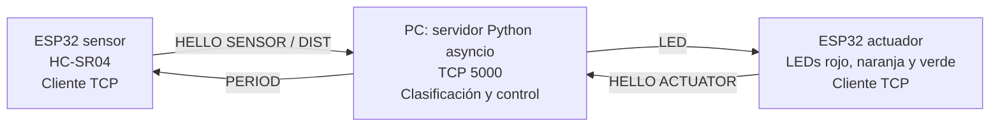

# Plan general — Integración de Objetos Inteligentes con TCP/IP

Estado: pendiente de revisión y aprobación. Fecha: 11 de octubre de 2026.

Este plan es de un solo uso. Se basa en `practica.md`, `AGENTS.md` y el diseño existente en `protocolo.md`. Describe trabajo futuro; no acredita implementación ni pruebas realizadas.

## 1. Objetivo y alcance

Construir dos clientes ESP32 conectados por WiFi a un servidor TCP en PC. El primero mide distancias con un HC-SR04; el servidor clasifica las lecturas y ordena al segundo controlar tres LEDs. Entregar código orientado a objetos, documentación, evidencias reales e informe Markdown conforme a la práctica.

## 2. Arquitectura



Ambos ESP inician conexiones persistentes al servidor dentro de la misma red WiFi. El servidor concentra la clasificación; el actuador genera el parpadeo localmente. No existe comunicación directa entre ESP.

| Componente | Responsabilidad | Tecnología |
|---|---|---|
| Servidor | Registrar roles, recibir lecturas, clasificar, enviar y refrescar órdenes, gestionar fallas | Python y `asyncio`, según `protocolo.md` |
| Sensor | Medir, detectar lecturas inválidas, enviar distancia, aplicar periodo y reconectar | ESP32 + HC-SR04; PlatformIO solicitado |
| Actuador | Recibir patrones, controlar tres LEDs, apagar ante pérdida de control y reconectar | ESP32 + tres LEDs; PlatformIO solicitado |

Se propone C++ con Arduino para ambos ESP, sin librerías externas iniciales. Modelo exacto de placa y framework pendientes de confirmación. Antes de cablear se acordarán los GPIO y se verificará la adaptación del nivel eléctrico de ECHO, alimentación y resistencias de los LEDs según el hardware disponible.

## 3. Decisiones y propuestas para aprobación

### Base existente

Conservar el protocolo ASCII delimitado por LF de `protocolo.md`: `HELLO`, `DIST`, `PERIOD` y `LED`, puerto 5000, periodo inicial de 250 ms, refresco de órdenes cada segundo y reconexión cada 3 segundos. Conservar el apagado tras tres `DIST ERR` consecutivos, el timeout del sensor de `max(2 s, 3 × PERIOD)` y el timeout del actuador de 5 segundos.

Antes de implementar el parser se debe precisar si el máximo de 32 bytes incluye LF y resolver la precedencia entre ignorar mensajes malformados y cerrar por un rol inválido. También se debe precisar si los 500 ms de parpadeo representan el ciclo completo o cada cambio de estado. Propuesta: incluir LF, cerrar ante `HELLO` con rol inválido y usar ciclo completo de 500 ms, con 250 ms encendido y 250 ms apagado. Estas precisiones requieren revisión; no se modifica el protocolo existente en esta etapa.

### Control propuesto, pendiente de aprobación

Rango de trabajo propuesto: 2 a 200 cm inclusive, sujeto a validación física. Una lectura fuera de ese intervalo se considera inválida y se transmite como `DIST ERR`.

| Distancia válida | Clasificación | Orden |
|---|---|---|
| 2 ≤ d < 50 cm | Cerca | `LED B00` |
| 50 ≤ d < 100 cm | Intermedia | `LED 0B0` |
| 100 ≤ d ≤ 200 cm | Lejos | `LED 00S` |

Los intervalos son contiguos y no se solapan dentro del rango de trabajo. Se propone adoptar los umbrales ilustrativos de la práctica; no se consideran obligatorios ni aprobados todavía.

### Objetivos medibles propuestos

| Atributo | Objetivo de aceptación | Verificación prevista |
|---|---|---|
| Estabilidad | Al menos 10 minutos sin reinicios ni bloqueos | Ejecución continua de los tres componentes con registro de incidentes |
| Exactitud | Error absoluto máximo de 3 cm entre 2 y 200 cm | Comparación con cinta métrica en varias posiciones y repeticiones |
| Respuesta | Como máximo 1 segundo de extremo a extremo | Medir desde cambio físico de rango hasta respuesta visible del LED |
| Muestreo | Al menos 2 lecturas/s en operación normal | Contar lecturas recibidas en ventanas temporales; configuración nominal de 250 ms |

El protocolo permite periodos de hasta 5000 ms, que no satisfacen el objetivo de muestreo. Las pruebas de aceptación usarán 250 ms; se distinguirá capacidad del protocolo de configuración de operación.

## 4. Estructura propuesta

```text
practica.md
AGENTS.md
protocolo.md
.gitignore
README.md
report.md
server/
sensor/
    platformio.ini
    include/
        config.h.example
    src/
        main.cpp
actuator/
    platformio.ini
    include/
        config.h.example
    src/
        main.cpp
docs/
    requirements.md
    architecture.md
    circuits.md
    classes.md
    sequence.md
    protocol.md
    implementation.md
    testing.md
    results.md
plans/
    general-plan.md
    server-plan.md
    sensor-plan.md
    actuator-plan.md
```

Cada ESP tendrá un proyecto PlatformIO independiente. Se crearán archivos y carpetas cuando se necesiten. Los archivos reales `include/config.h`, las salidas `.pio/` y las cachés se excluirán de Git. Los ejemplos contendrán únicamente valores ficticios. Los pines, periodos, rangos y parámetros de conexión se concentrarán en configuraciones visibles por componente.

`protocolo.md` se conserva como referencia existente. Después de implementar, `docs/protocol.md` describirá el comportamiento real y la referencia original podrá enlazarlo para evitar especificaciones divergentes.

## 5. Orden de trabajo y puntos de revisión

1. Revisar y aprobar este plan, confirmar las placas y framework, y acordar los valores propuestos y las precisiones del protocolo.
2. Inicializar los proyectos PlatformIO solicitados en `sensor/` y `actuator/`: configuración de placa y framework, entrada mínima, ejemplos de configuración e ignorados. Compilar ambos y registrar cualquier impedimento del entorno. Esta inicialización no implementa aún medición, red ni actuación.
3. Elaborar exactamente tres subplanes: `server-plan.md`, `sensor-plan.md` y `actuator-plan.md`. Cada uno detallará pocas clases con responsabilidades claras, archivos y pasos. Someterlos a revisión antes de implementar cada componente.
4. Implementar el servidor y comprobar clasificación, límites y tratamiento del flujo TCP con clientes simulados.
5. Implementar y verificar el sensor: medición, timeout de eco, envío periódico y reconexión. Implementar y verificar el actuador: patrones, temporización no bloqueante y apagado por timeout.
6. Integrar los tres componentes, ejecutar pruebas funcionales, de fallas y de aceptación física. Resolver defectos y actualizar la documentación afectada.
7. Sintetizar la documentación en `report.md`, redactar conclusiones y recomendaciones con la persona y preparar la demostración y defensa individual antes del 13 de octubre de 2026.

Después de implementar cada pieza se escribirá su documentación correspondiente en `docs/`, con diagramas Mermaid y enlaces al código. Los cambios respecto al plan se comunicarán; el plan no se mantendrá como documentación viva.

## 6. Verificación y trazabilidad previstas

| Requisito | Evidencia prevista |
|---|---|
| RF1: medición | Distancias de referencia, lecturas y errores absolutos del HC-SR04 |
| RF2: clasificación | Casos por debajo, exactamente en y por encima de 50 y 100 cm; extremos del rango válido |
| RF3: actuación | Observación de los tres patrones, parpadeo y apagado por falla |
| RF4: TCP sobre WiFi | Registros de registro por rol, envío de lectura y orden, y reconexión |
| Robustez | Mensajes fragmentados y concatenados, líneas largas, mensajes inválidos, roles duplicados, pérdida de WiFi, sensor y servidor |
| No funcionales | Mediciones de estabilidad, exactitud, respuesta y muestreo comparadas con objetivos aprobados |

Las pruebas automatizadas del servidor cubrirán decisiones de control y procesamiento del flujo TCP. La compilación de firmware no se presentará como prueba del circuito. Las mediciones físicas se harán con los equipos reales y se documentarán en `docs/testing.md` y `docs/results.md`; cualquier dato faltante se marcará `PENDIENTE`.

## 7. Entrega

El README explicará instalación, configuración, compilación, carga y ejecución. El informe incluirá las ocho secciones de `practica.md`, diagramas de ambos circuitos y evidencias enlazadas. Cada integrante realizará sus propios commits. La persona entregará el enlace del repositorio por el LMS; no se harán commits ni push automáticos.
