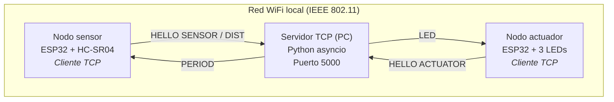
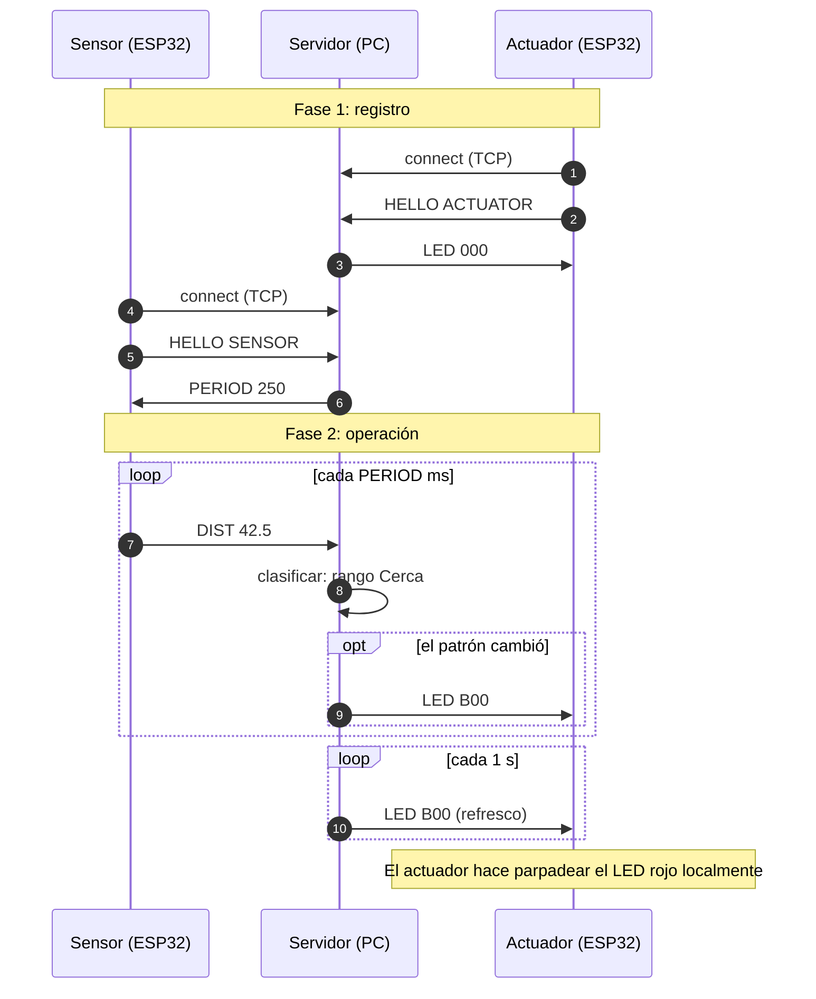
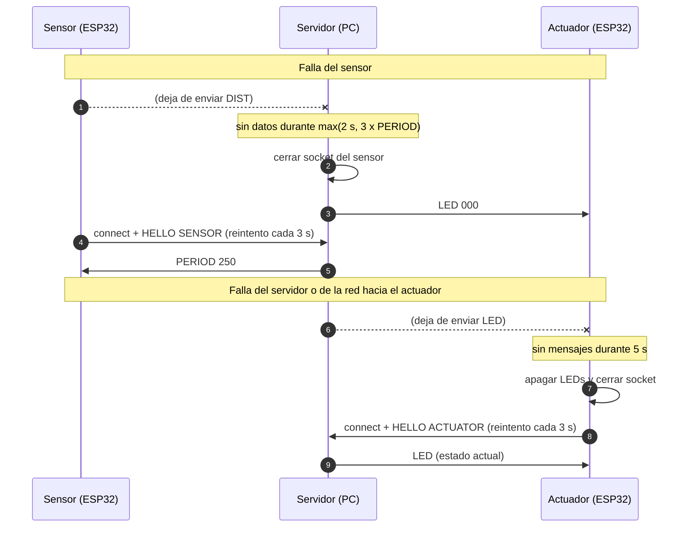

## 2. Análisis y Diseño

### 2.1 Arquitectura del sistema



Uso de las capas del modelo TCP/IP:

| Capa | Tecnología utilizada |
|------|----------------------|
| Aplicación | Protocolo propio de texto (sección 2.5) |
| Transporte | TCP, conexiones persistentes, puerto 5000 del servidor |
| Internet | IPv4; el servidor tiene una IP fija o reservada por DHCP |
| Acceso a la red | WiFi IEEE 802.11 |

Configuración de red:

- Los tres dispositivos están en la misma red local.
- El servidor escucha en `0.0.0.0:5000`.
- La IP del servidor se configura en el firmware de ambos ESP32. Se recomienda una reserva DHCP en el router para que no cambie.
- El firewall de la PC debe permitir conexiones entrantes TCP al puerto 5000.

### 2.2 Diagramas de secuencia

#### 2.2.1 Operación normal



#### 2.2.2 Escenarios de falla



### 2.3 Especificación del protocolo de aplicación

#### 2.3.1 Formato general

- Protocolo de texto ASCII sobre TCP. Cada mensaje es **una línea** terminada en `\n` (LF).
- Forma general: `COMANDO [argumento]`, con un único espacio como separador.
- Longitud máxima de una línea: 32 bytes. Una línea más larga se descarta hasta el siguiente `\n`.
- TCP es un flujo de bytes sin límites de mensaje; el `\n` es el delimitador que permite separarlos.
- Una línea desconocida o mal formada se ignora, sin responder y sin cerrar la conexión. Se registra en el log del servidor.
- Las conexiones son persistentes: se abren una vez y se reutilizan.

#### 2.3.2 Mensajes

| Dirección | Mensaje | Argumento | Ejemplo | Bytes |
|-----------|---------|-----------|---------|-------|
| ESP → Servidor | `HELLO` | Rol: `SENSOR` o `ACTUATOR` | `HELLO SENSOR` | 13 a 15 |
| Sensor → Servidor | `DIST` | Distancia en cm con un decimal, o `ERR` | `DIST 42.5` / `DIST ERR` | 9 a 11 |
| Servidor → Sensor | `PERIOD` | Periodo de medición en ms (entero entre 100 y 5000) | `PERIOD 250` | 11 a 12 |
| Servidor → Actuador | `LED` | Tres caracteres, uno por LED (rojo, naranja, verde) | `LED B00` | 8 |

Estados de cada LED en el mensaje `LED`:

| Carácter | Significado |
|----------|-------------|
| `0` | Apagado |
| `S` | Encendido fijo (*solid*) |
| `B` | Parpadeando (*blink*) |

Ejemplos: `LED B00` rojo parpadeando · `LED 0B0` naranja parpadeando · `LED 00S` verde fijo · `LED 000` todos apagados.

Gramática resumida:

```
mensaje = hello / dist / period / led
hello   = "HELLO" SP ( "SENSOR" / "ACTUATOR" ) LF
dist    = "DIST" SP ( 1*3DIGIT "." DIGIT / "ERR" ) LF
period  = "PERIOD" SP 3*4DIGIT LF
led     = "LED" SP 3estado LF
estado  = "0" / "S" / "B"
```

El parpadeo lo genera el actuador de forma local, con un periodo fijo de 500 ms (encendido y apagado), usando un temporizador no bloqueante. Así el ritmo del parpadeo no depende de la red.

#### 2.3.3 Reglas de comportamiento

1. El ESP abre la conexión TCP y envía `HELLO` con su rol. Si el rol no es válido, el servidor cierra el socket.
2. Si llega un `HELLO` de un rol que ya tiene un socket asociado, el servidor cierra el socket anterior y conserva el nuevo.
3. Tras `HELLO SENSOR`, el servidor envía `PERIOD`. Si todavía no lo recibió, el sensor usa 250 ms por defecto.
4. Tras `HELLO ACTUATOR`, el servidor envía el `LED` correspondiente al estado actual.
5. El sensor envía `DIST` cada `PERIOD` ms. Si la lectura falla (sin eco o fuera de rango), envía `DIST ERR`.
6. El servidor envía `LED` al actuador cuando el patrón cambia y, además, cada 1 s como refresco.
7. El sensor aplica `PERIOD` de inmediato; si el valor está fuera de 100 a 5000 ms, lo limita a ese intervalo. El mínimo de 100 ms respeta el tiempo entre disparos del HC-SR04.
8. Cualquier ESP que pierda la conexión reintenta cada 3 s y repite el `HELLO`.

Parámetros de tiempo:

| Parámetro | Valor | Dónde se aplica |
|-----------|-------|-----------------|
| `PERIOD` por defecto | 250 ms | Servidor (lo envía) y firmware del sensor (valor de respaldo) |
| Rango permitido de `PERIOD` | 100 a 5000 ms | Servidor y sensor |
| Timeout de silencio del sensor | `max(2 s, 3 × PERIOD)` | Servidor |
| Errores `DIST ERR` consecutivos tolerados | 2 (al tercero se pasa a `000`) | Servidor |
| Refresco de estado `LED` | 1 s | Servidor |
| Timeout de silencio del servidor | 5 s | Actuador |
| Periodo de parpadeo | 500 ms | Actuador |
| Reintento de conexión | 3 s | Ambos ESP32 |
